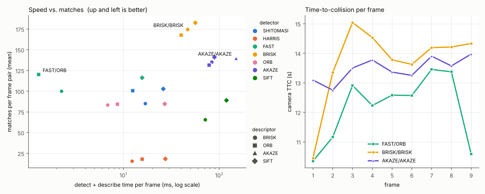
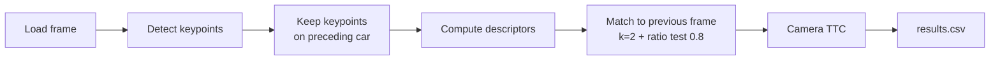
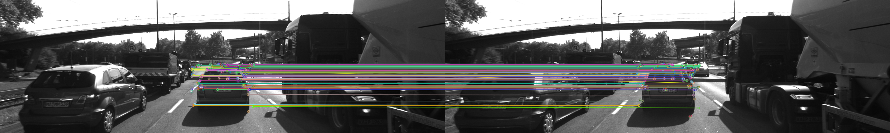

# 2D Feature Tracking for Collision Detection

Tracks keypoints on the car ahead across 10 KITTI camera frames, compares 7 keypoint detectors and 6 descriptors, and uses the tracked keypoints to estimate **time-to-collision (TTC)** from the camera alone.



## How it works



- **Detectors:** Shi-Tomasi, Harris (with non-maximum suppression), FAST, BRISK, ORB, AKAZE, SIFT
- **Descriptors:** BRISK, ORB, AKAZE, SIFT, and BRIEF and FREAK if OpenCV has `xfeatures2d` (see [Build](#build))
- **Matching:** brute force (default) or FLANN. Hamming distance for binary descriptors, L2 for SIFT. Ambiguous matches are dropped with Lowe's ratio test.
- **Vehicle region:** a fixed rectangle `(535, 180, 180×150)` around the car ahead.
- **TTC:** if the car gets closer, the distances between its keypoints grow from one frame to the next. Take the median ratio `r` of those distances across all pairs of matches, then `TTC = −Δt / (1 − r)` with Δt = 0.1 s (10 Hz camera). The median keeps outlier matches from skewing the result. See [`src/ttc.cpp`](src/ttc.cpp).



## Build

Requires CMake ≥ 3.10, a C++17 compiler and OpenCV ≥ 4.4 (SIFT is part of the main module from 4.4 on).

```bash
sudo apt-get install cmake build-essential libopencv-dev
cmake -S . -B build -DCMAKE_BUILD_TYPE=Release
cmake --build build --parallel
```

BRIEF and FREAK live in `opencv_contrib/xfeatures2d`. Ubuntu's `libopencv-contrib-dev` does not include that module, so you need an OpenCV build with `-DOPENCV_EXTRA_MODULES_PATH=<opencv_contrib>/modules`. CMake detects it automatically and reports whether BRIEF/FREAK are enabled.

## Run

```bash
./build/2D_feature_tracking                                  # every combination, about 15 s
./build/2D_feature_tracking --detector FAST --descriptor ORB --save
python3 scripts/analyze.py --plot results/summary.png        # summary table and chart (chart needs matplotlib)
```

| Option | Default |
|---|---|
| `--detector`, `--descriptor` | all available |
| `--matcher MAT_BF\|MAT_FLANN` | `MAT_BF` |
| `--selector SEL_NN\|SEL_KNN` | `SEL_KNN` |
| `--data-dir DIR` | `images/KITTI/2011_09_26/image_00/data` |
| `--out-dir DIR` | `results` |
| `--save` | off; writes match images to `<out-dir>/matches/` |

The program writes one row per frame and combination to `results/results.csv`: keypoint count and mean size, detection and description time, number of matches, and TTC.

## Results

Run on OpenCV 4.6 (no `xfeatures2d`) on a 4-core VM. Times include detection on the full frame plus description of the vehicle keypoints. Absolute times vary by about ±20 % between runs, so compare them relative to each other. AKAZE descriptors only work with AKAZE keypoints, and ORB descriptors fail on SIFT keypoints, so those pairs are skipped.

| Detector / Descriptor | Keypoints in ROI | Matches | ms / frame | TTC median (s) | TTC range (s) |
|---|---:|---:|---:|---:|---:|
| BRISK / SIFT | 276 | 183 | 55.9 | 15.3 | 12.5 – 18.3 |
| BRISK / BRISK | 276 | 174 | 46.8 | 14.2 | 10.4 – 15.0 |
| BRISK / ORB | 276 | 168 | 39.9 | 13.4 | 11.4 – 16.1 |
| AKAZE / SIFT | 167 | 141 | 88.7 | 13.6 | 12.5 – 13.9 |
| AKAZE / AKAZE | 167 | 140 | 149.7 | 13.5 | 12.8 – 14.0 |
| AKAZE / BRISK | 167 | 135 | 83.1 | 13.6 | 12.5 – 13.8 |
| AKAZE / ORB | 167 | 132 | 78.0 | 13.0 | 12.3 – 13.9 |
| FAST / ORB | 149 | 120 | 1.3 | 12.6 | 10.3 – 13.4 |
| FAST / SIFT | 149 | 116 | 15.6 | 12.8 | 11.0 – 15.2 |
| SHITOMASI / SIFT | 118 | 103 | 26.0 | 13.3 | 11.9 – 15.2 |
| SHITOMASI / ORB | 118 | 101 | 12.5 | 13.0 | 11.4 – 14.5 |
| FAST / BRISK | 149 | 100 | 2.3 | 11.7 | 11.2 – 13.9 |
| SIFT / SIFT | 139 | 89 | 118.5 | 12.8 | 10.2 – 15.6 |
| SHITOMASI / BRISK | 118 | 85 | 16.9 | 12.8 | 10.2 – 13.8 |
| ORB / SIFT | 116 | 85 | 26.8 | 15.4 | 11.8 – 78.8 |
| ORB / ORB | 116 | 85 | 8.7 | 17.3 | 13.7 – 35.8 |
| ORB / BRISK | 107 | 83 | 6.9 | 17.3 | 11.0 – 98.2 |
| SIFT / BRISK | 138 | 66 | 71.0 | 11.5 | 8.6 – 13.1 |
| HARRIS / SIFT | 26 | 18 | 27.2 | 12.8 | 8.9 – 39.1 |
| HARRIS / ORB | 26 | 18 | 15.6 | 16.9 | 8.9 – 47.4 |
| HARRIS / BRISK | 26 | 16 | 12.3 | 13.0 | 8.2 – 69.7 |

- **FAST / ORB is the practical choice:** about 120 matches in about 1.3 ms per frame, which is 30–40× faster than the BRISK pairs that find the most matches, and its TTC is stable.
- **The BRISK detector finds the most keypoints and matches**, but costs about 40–55 ms per frame.
- **AKAZE gives the steadiest TTC:** every AKAZE pair stays within 12.3–14.0 s across the sequence.
- **Avoid ORB and Harris keypoints for TTC.** ORB keypoints bunch together and Harris finds only about 26 on the car, so a few bad matches move the median ratio. The result is TTC spikes of 35–98 s.

## Layout

```
src/main.cpp        pipeline, CLI, CSV output
src/features.*      detectors, descriptors, matching
src/ttc.*           camera-based TTC
scripts/analyze.py  summary table and chart from results.csv
results/            committed results from the run above
images/KITTI/       10 input frames
```

## Credits

Based on the [Udacity Sensor Fusion Nanodegree](https://github.com/udacity/SFND_2D_Feature_Tracking) starter code (MIT, see [LICENSE](LICENSE)). Images are from the [KITTI dataset](https://www.cvlibs.net/datasets/kitti/) (CC BY-NC-SA 3.0).
